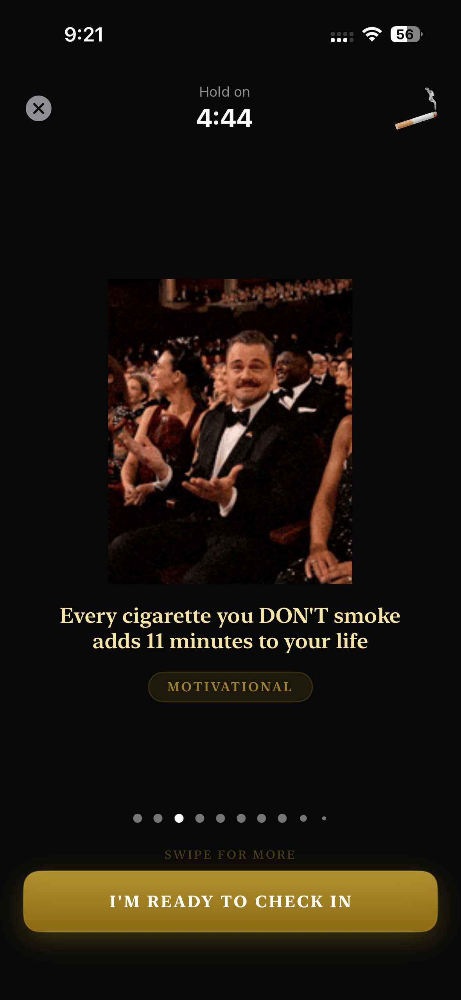
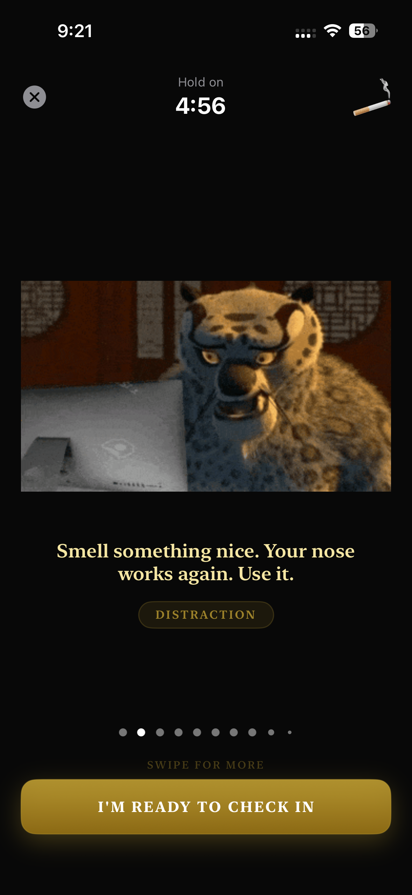
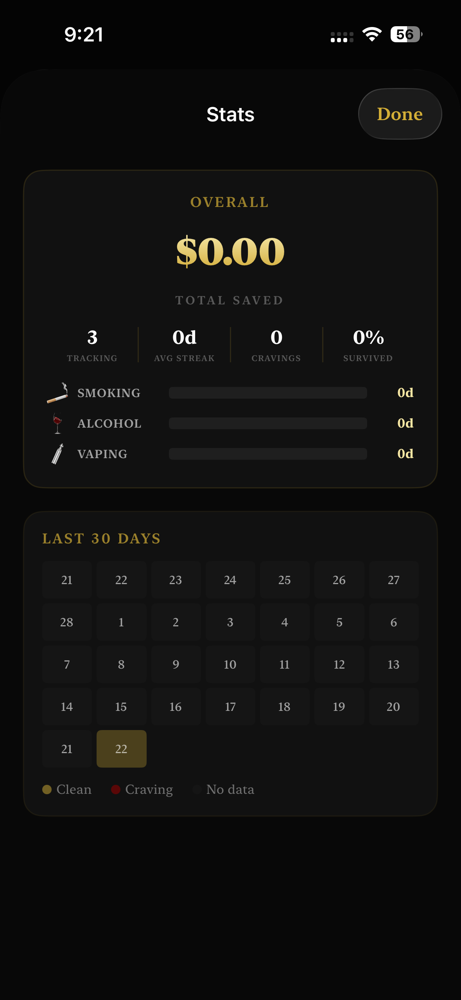

<p align="center">
  
</p>

<h1 align="center">Quit All - Break Every Habit</h1>

<p align="center">Quit smoking, vaping, alcohol, porn, social media, weed, gambling, overspending, and caffeine — all in one app.</p>

**Website:** [quit-all.vercel.app](https://quit-all.vercel.app)

## Features

- **8-Step Onboarding Funnel** — Quiz, personalized analysis, symptom check, feature showcase, reviews, custom quit plan, and paywall
- **Streak Tracking** — Giant streak counter with gold gradient progress ring toward next milestone
- **Multiple Addictions** — Track as many as you want with drag-to-reorder horizontal scroll cards
- **SOS Craving Screen** — Full-screen takeover with animated GIFs from Giphy, 2,790+ motivational memes, trigger logging, and outcome tracking
- **Stats & Patterns** — Overall summary, calendar heatmap, craving frequency charts, hourly heatmaps, trigger breakdown, and pattern insights
- **Cost Calculator** — Money saved, projection slider up to 5 years, "what you could buy" cards, life time saved
- **Currency Selection** — 9 currencies (USD, EUR, GBP, INR, CAD, AUD, JPY, CNY, BRL), chosen during onboarding via dropdown
- **Milestones** — 9 progressive milestones with health facts and shareable cards
- **Relapse Flow** — No-shame relapse logging (activity, mood, plan) with instant streak reset
- **Smart Notifications** — Pattern-based alerts at your highest risk times and danger zones
- **Edit & Reorder** — Edit daily spending, motivation, drag-to-reorder, add/remove addictions, and reset order from Settings
- **StoreKit 2 Paywall** — 3-day free trial, Monthly ($7.99) and Yearly ($49.99) subscriptions, manage subscription from Settings
- **Haptic Feedback** — Tactile feedback on all key interactions
- **Dark Casino Gold Theme** — Luxury dark theme with gold accents, Cormorant serif fonts, and Gemini-generated icons

## Screenshots

<p align="center">
  
  
  
  
</p>

## Tech Stack

- Swift + SwiftUI (iOS 17+)
- CoreData (all data local, no server)
- StoreKit 2 (subscriptions)
- UserNotifications (smart alerts)
- Giphy API (GIF search for SOS screen)
- ImageIO (animated GIF rendering)
- No backend, no sign-in required

## Setup

1. Clone the repo
2. Create `Secrets.xcconfig` in the project root:
   ```
   GIPHY_API_KEY = your_giphy_api_key
   ```
   Get a free key at [developers.giphy.com](https://developers.giphy.com)
3. Open `Quit All.xcodeproj` in Xcode
4. Build and run

The pre-build script reads `Secrets.xcconfig` and generates `EnvConfig.swift` automatically. Both files are gitignored — no API keys in the repo.

## Project Structure

```
Quit All/
├── Quit_AllApp.swift              # App entry point
├── Persistence.swift              # CoreData stack
├── EnvConfig.swift                # API key config (auto-generated, gitignored)
├── Core/
│   ├── HapticManager.swift        # Haptic feedback
│   ├── NotificationManager.swift  # Smart pattern-based notifications
│   └── PaywallManager.swift       # StoreKit 2 subscriptions
├── AI/
│   ├── PatternDetector.swift      # Craving pattern analysis (on-device)
│   └── RelapseAnalyzer.swift      # Relapse trend analysis
├── Memes/
│   ├── GiphyManager.swift         # Giphy API + animated GIF renderer
│   ├── MemeData.swift             # 2,790 curated text memes
│   └── MemeLibrary.swift          # Meme filtering & selection
├── Tracking/
│   ├── AddictionTracker.swift     # CRUD operations + relapse logging
│   ├── StreakEngine.swift         # Streak calculations + milestone progress
│   ├── CostCalculator.swift       # Savings, projections & life hours saved
│   └── CravingLogger.swift        # Craving event logging & queries
├── Models/
│   ├── Addiction.swift            # AddictionType enum, colors, icons
│   ├── CravingEvent.swift         # Triggers & moods
│   ├── Milestone.swift            # 9 milestone definitions + health facts
│   └── RelapseEvent.swift         # Relapse activities
├── Views/
│   ├── OnboardingView.swift       # 8-step conversion funnel
│   ├── PaywallView.swift          # Subscription paywall
│   ├── HomeView.swift             # Dashboard + gold streak ring
│   ├── SOSView.swift              # Craving intervention + GIFs + confetti
│   ├── StatsView.swift            # Overall summary + charts + insights
│   ├── CostView.swift             # Savings calculator + projections
│   ├── MilestonesView.swift       # Progressive milestones + share cards
│   ├── RelapseView.swift          # No-shame relapse flow
│   ├── AddictionsView.swift       # Manage, edit & reorder addictions
│   └── SettingsView.swift         # Settings, manage subscription, full data reset
└── Quit_All.xcdatamodeld          # CoreData model (4 entities)
```

## Supported Addictions

| Type | Color | Icon |
|------|-------|------|
| Smoking | `#607D8B` | Gemini-generated |
| Vaping | `#607D8B` | Gemini-generated |
| Alcohol | `#FF8F00` | Gemini-generated |
| Porn | `#7B1FA2` | Gemini-generated |
| Social Media | `#1565C0` | Gemini-generated |
| Weed | `#2E7D32` | Gemini-generated |
| Gambling | `#C62828` | Gemini-generated |
| Overspending | `#F9A825` | Gemini-generated |
| Caffeine | `#4E342E` | Gemini-generated |

## Links

- **Website:** [quit-all.vercel.app](https://quit-all.vercel.app)
- **Privacy Policy:** [quit-all.vercel.app/privacy](https://quit-all.vercel.app/privacy)
- **Terms of Service:** [quit-all.vercel.app/terms](https://quit-all.vercel.app/terms)

## License

All rights reserved. © 2026 Apoorv Darshan.
