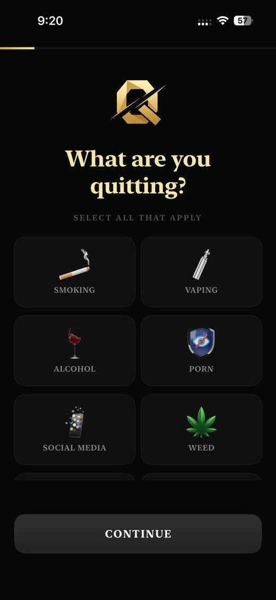
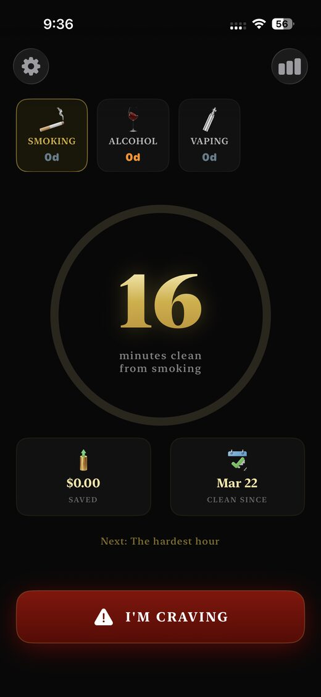
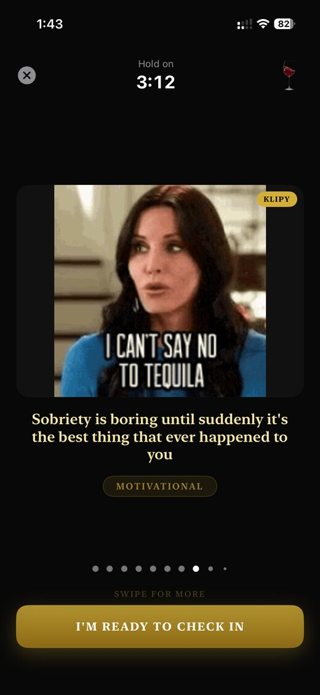
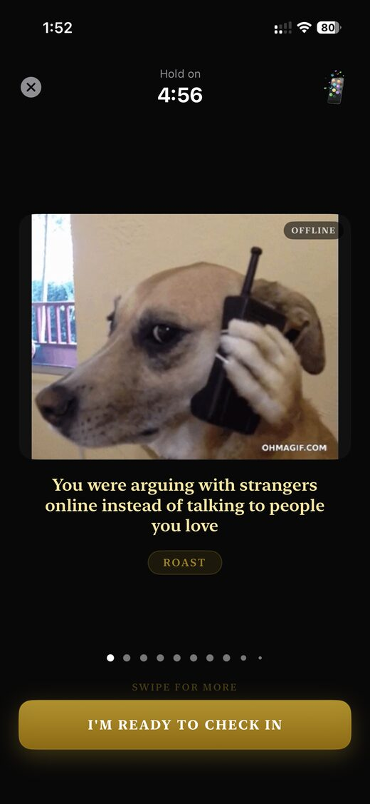

<p align="center">
  
</p>

<h1 align="center">Quit All — Break Every Habit</h1>

<p align="center">
  Quit smoking, vaping, alcohol, porn, social media, weed, gambling, overspending, and caffeine —<br/>
  all in one app. Powered by streaks, SOS GIF interventions, offline fallbacks, 2,790+ memes, and no shame.
</p>

<p align="center">
  <a href="https://apps.apple.com/us/app/quit-all-break-every-habit/id6760978934"><b>Download on the App Store</b></a> ·
  <a href="https://quit-all.com"><b>quit-all.com</b></a> ·
  <a href="https://quit-all.com/privacy">Privacy</a> ·
  <a href="https://quit-all.com/terms">Terms</a>
</p>

---

Monorepo for the **Quit All** iOS app and its marketing website.

## Repo Structure

```
.
├── ios/    # SwiftUI iOS app (Xcode project) → App Store
└── web/    # Next.js marketing site → quit-all.com
```

## Preview

<p align="center">
  
  
  
  
  
</p>

<p align="center">
  <sub>Onboarding · Home streaks · SOS GIF intervention · Offline fallback loops · Stats</sub>
</p>

## What's inside

### Features

- **9 addictions, one app** — smoking, vaping, alcohol, porn, social media, weed, gambling, overspending, caffeine
- **SOS craving button** — full-screen takeover with Powered by KLIPY GIFs, bundled offline video loops, and 2,790+ curated memes (motivational, roast, consequence, distraction, relatable)
- **Streak tracking** — giant counter with gold gradient progress ring toward the next milestone
- **Pattern detection** — on-device hourly heatmaps and trigger analysis of your cravings
- **Cost calculator** — money saved, life hours reclaimed, 5-year projection slider, "what you could buy" cards
- **Milestones** — 9 progressive health milestones with shareable cards
- **Home and Lock Screen widgets** — quick progress check-ins outside the app
- **No-shame relapse flow** — log activity, mood, and plan without losing progress stigma
- **Smart notifications** — alerts at your personal high-risk times
- **Hard paywall + 7-day free trial** — RevenueCat + StoreKit 2, Weekly $6.99, Yearly $34.99, Lifetime $69.99

### Tech Stack

| iOS (`ios/`) | Web (`web/`) |
|---|---|
| Swift + SwiftUI (iOS 17+) | Next.js + TypeScript |
| CoreData (local-only, no backend) | Vanilla CSS (no Tailwind) |
| RevenueCat + StoreKit 2 | Framer Motion (animations) |
| WidgetKit + UserNotifications | JSON-LD structured data for SEO |
| KLIPY GIF proxy + bundled MP4 fallbacks | Cloudflare Workers via OpenNext |
| Dark casino-gold theme, Cormorant serif | Same theme system as iOS |

## Running locally

### iOS

```bash
cd ios
open "Quit All.xcodeproj"
```

Optional SOS video loops are manifest-driven. Add compressed silent MP4/MOV clips under `ios/Quit All/Memes/VideoLoops/` and list them in `ios/Quit All/Memes/VideoLoops.json`.

Full setup → [`ios/README.md`](ios/README.md)

### Web

```bash
cd web
npm install
npm run dev    # http://localhost:3000
```

The `web/` folder deploys to Cloudflare Workers through the OpenNext adapter:

```bash
cd web
npm run preview   # build and test in the Workers runtime
npm run deploy    # build and deploy with Wrangler
```

KLIPY requests are proxied through Cloudflare at `/api/klipy/...` so the iOS app never ships the API key. Configure `KLIPY_API_KEY` with `wrangler secret put KLIPY_API_KEY`, then call endpoints like `/api/klipy/v2/search?q=smoking`. Online GIF content shows Powered by KLIPY attribution in the app. Optional overrides: `KLIPY_API_BASE_URL` and `KLIPY_API_KEY_PARAM`.

The iOS RevenueCat public SDK key is loaded from `/api/app-config` so it can be rotated without shipping a new app build. Configure `REVENUECAT_IOS_API_KEY` as a Cloudflare Worker secret. The app falls back to its bundled public key if the config endpoint is unavailable.

## Links

- **App Store:** https://apps.apple.com/us/app/quit-all-break-every-habit/id6760978934
- **Website:** https://quit-all.com
- **Privacy Policy:** https://quit-all.com/privacy
- **Terms of Service:** https://quit-all.com/terms

## License

All rights reserved. © 2026 Apoorv Darshan.
